# DEAL: Screens for Redesign

DEAL is a negotiation copilot. The **buyer** wears Ray-Ban Meta Display glasses that show short live cues ("Redirect to total price") while they negotiate, for example buying a used car. When both sides agree, the agreement is **locked**. The **seller's** iPhone then becomes a Tap to Pay terminal that can only charge the agreed amount. If the seller tries to add a surprise fee, the buyer's phone blocks it.

One SwiftUI iOS app, two modes: **Buyer** and **Seller**. The demo is a 2023 Honda Accord: asking $38,000, the buyer's target $34,500, deal closes at $34,600, and the seller then tries to add a $1,200 "protection package", which gets blocked.

Screenshots are from the iPhone 18 Pro Simulator (iOS 27.1, light mode), captured from the current build. They're in [`screenshots/`](screenshots/).

## How to redesign with Claude

For each screen, give Claude the screenshot plus that screen's section below, and ask something like:

> Here's a screen from my SwiftUI app DEAL (description below). Redesign it: keep every piece of information and every action listed, but improve hierarchy, visual style and clarity. Give me a mockup plus SwiftUI code.

**Keep consistent across screens:**
- **Status colors:** green = good, yellow = careful, red = warning or blocked. They appear on the offer dot, progress bar, cue card and charge alert.
- **Money:** whole dollars in live views ($34,600) and cents on the terminal and receipt ($34,600.00).
- **"Locked to agreement":** the core trust idea. The terminal amount and the agreement fingerprint (`a3f9…c21`) should feel tamper-proof.
- **Cues:** 3–6 words long. They must read at a glance.

---

## Start

### A0. Mode picker
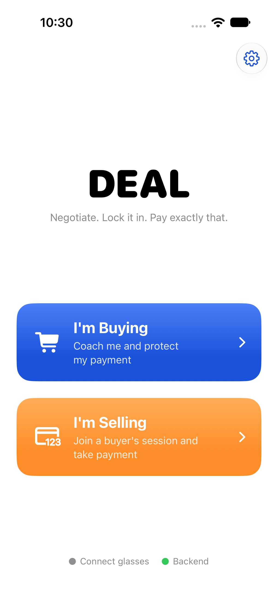
`ios/DEAL/App/ModePickerView.swift`
- The first screen.
- Two big buttons: **I'm Buying** ("Coach me and protect my payment") and **I'm Selling** ("Join a buyer's session and take payment").
- Glasses status dot / **Connect glasses** button, backend status, and a Settings gear.

### A1. Settings (sheet)
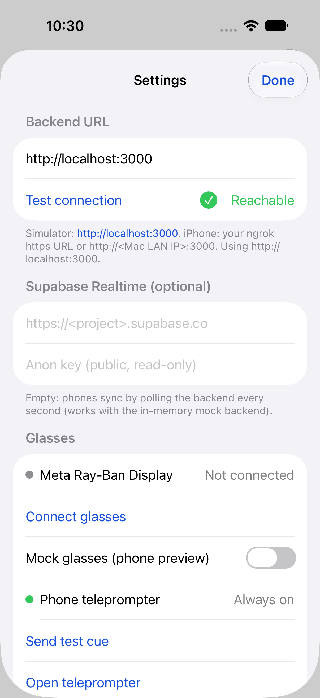
`ios/DEAL/App/SettingsView.swift`
- **Backend URL:** text field, Test connection, and a Reachable / Unreachable indicator.
- **Supabase Realtime:** two optional fields.
- **Glasses:**
  - Meta Ray-Ban Display status, Connect / Disconnect, Mock glasses toggle
  - Phone teleprompter "Always on"
  - Send test cue, Open teleprompter
- **Danger zone:** Leave current session, Delete all sessions, Reset settings.
- This is a developer and demo-operator screen, so it's low priority for polish.

---

## Buyer mode

### B1. Buyer Home
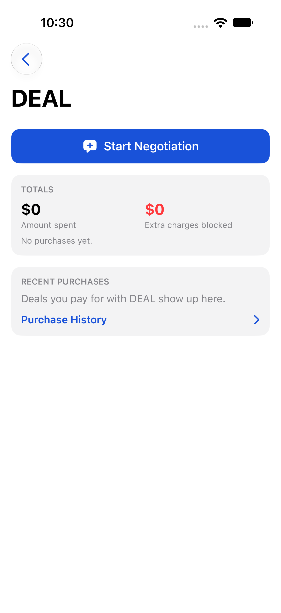
`ios/DEAL/Buyer/BuyerHomeView.swift`
- The root of buyer mode.
- **Start Negotiation**.
- **Active session** card to resume a running negotiation; not shown in the screenshot.
- **Totals:** amount spent, extra charges blocked (red), number of purchases and total saved.
- The 3 most recent purchases, with a Purchase History link.
- The screenshot shows the **empty state** before any purchase. Design the filled state too, using the B7 row style.

### B2. New Negotiation
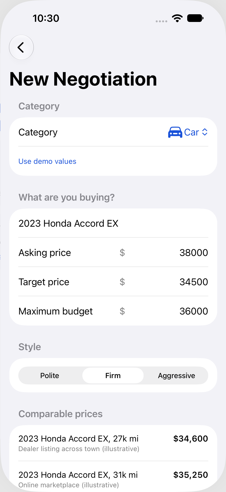
`ios/DEAL/Buyer/NewNegotiationView.swift`
- Category picker: Car / Pawn Shop / Marketplace / Electronics / Other.
- Item name, asking price, target price, max budget.
- Style: Polite / Firm / Aggressive.
- **Comparable prices** card with 3–4 illustrative listings.
- "Use demo values" and **Start Session**.

### B3. Live Session (main screen, most important)
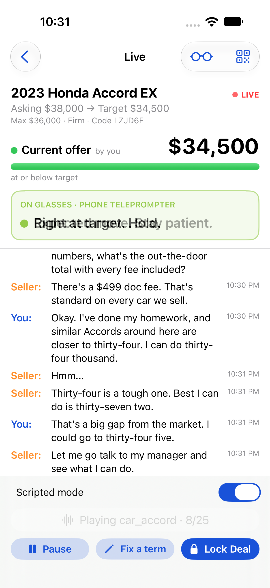
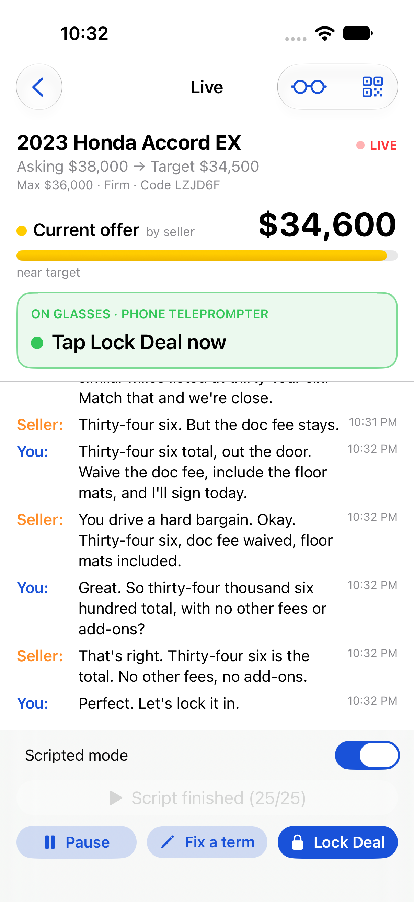
`ios/DEAL/Buyer/LiveSessionView.swift`
- **Pinned at the top:**
  - Item name and a LIVE / PAUSED badge
  - Asking → Target
  - Max · Style · join code
  - **Current offer** with a status dot, who made it, the big price and a colored progress bar
  - The **ON GLASSES** card: the exact cue the glasses are showing right now
- **Scrolls below:** "Terms so far" (price, fees, included items; uncertain terms marked "?") and the live transcript (Buyer / Seller lines with times).
- **Bottom bar:** Pause / Resume, **Fix a term**, **Lock Deal**, and a Scripted mode toggle that plays a sample conversation instead of using the mic.
- **Toolbar:** glasses icon (opens the teleprompter) and QR icon (shows the join code).
- The buyer glances at this mid-conversation, so the cue and current offer must win the visual hierarchy.

### B3a. Join code sheet
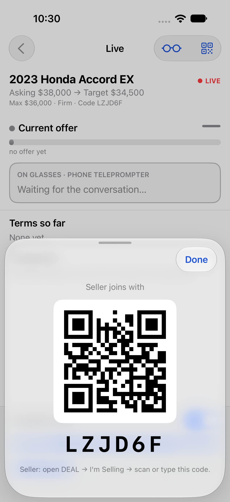
- Opens automatically when a session starts.
- QR code plus a 6-character join code for the seller to scan or type.

### B3b. Teleprompter (full screen)
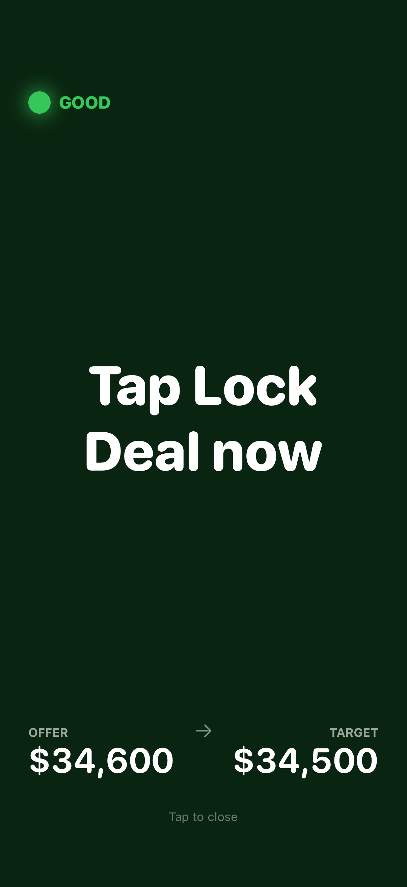
`ios/DEAL/Glasses/TeleprompterView.swift`
- A phone version of what the glasses show: the status word and dot, the big cue, and Offer → Target.
- It's also used as the projector mirror in the demo. Tap to close.

### B3c. Fix a term
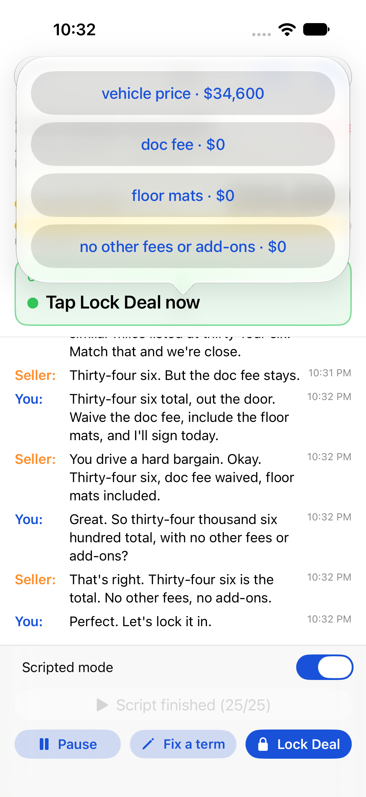
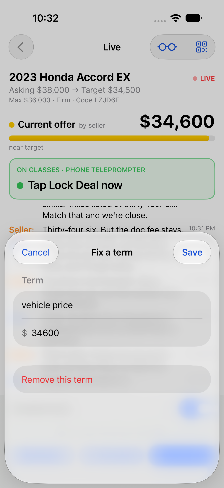
- Fixes an AI extraction mistake.
- First a picker ("Fix which term?"), then a sheet to edit the label and amount, or remove the term.

### B4. Agreement Review
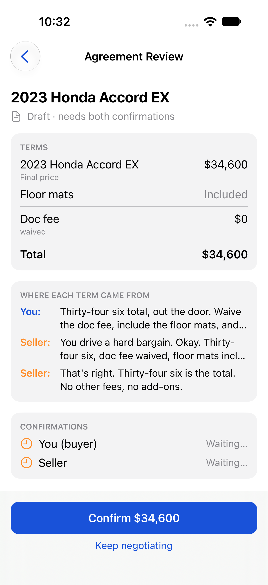
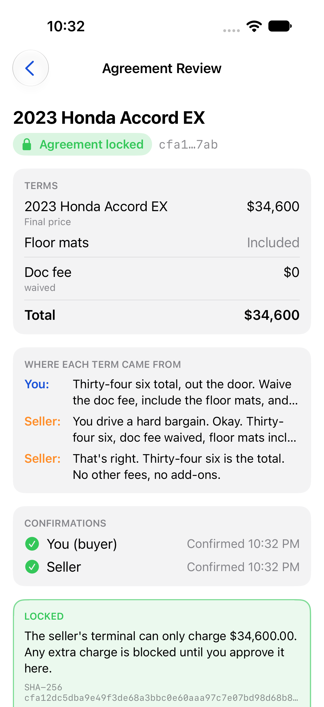
`ios/DEAL/Buyer/AgreementReviewView.swift`
- Final price, included items, fees, total.
- Each term links to its source transcript line.
- Open questions flagged by the AI.
- **Confirm** button and the seller's status (waiting / confirmed).
- **Locked state:** after both confirm, an "Agreement locked" badge with the short fingerprint. This moment should feel like a seal.

### B5. Charge Alert
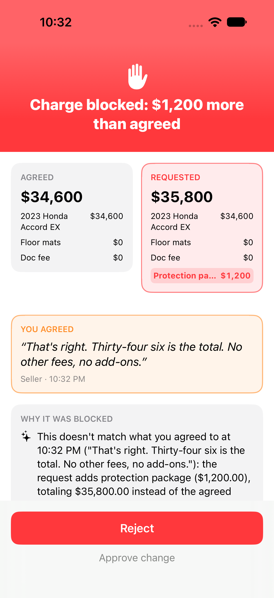
`ios/DEAL/Buyer/ChargeAlertView.swift`
- Appears when the seller tries to charge something different.
- Red banner: **"Charge blocked: $1,200 more than agreed"**.
- Agreed total and requested total side by side, with the extra line item highlighted.
- The contradicting transcript line with its timestamp, plus a one-sentence AI explanation.
- **Reject** (default) or **Approve change**.
- This is the hero moment of the demo.

### B6. Receipt
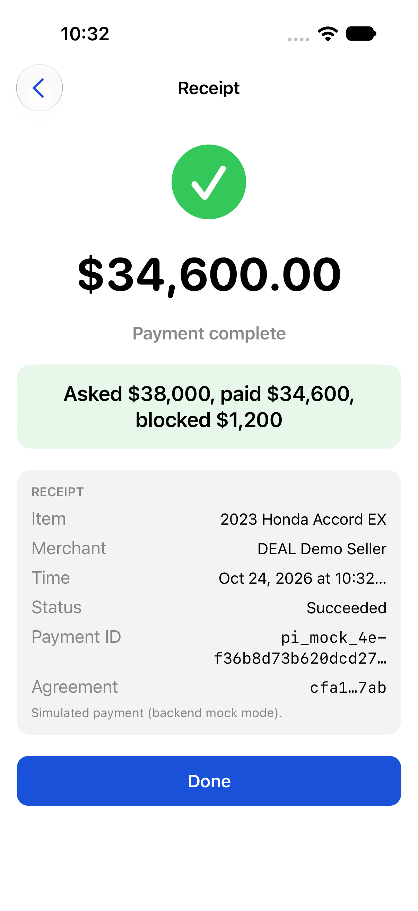
`ios/DEAL/Buyer/ReceiptView.swift`
- Amount, merchant, time, Stripe test payment ID, agreement fingerprint.
- Summary: *"Asked $38,000, paid $34,600, blocked $1,200"*.

### B7. Purchase History → Deal Detail
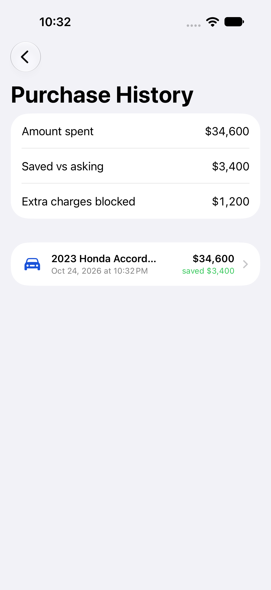
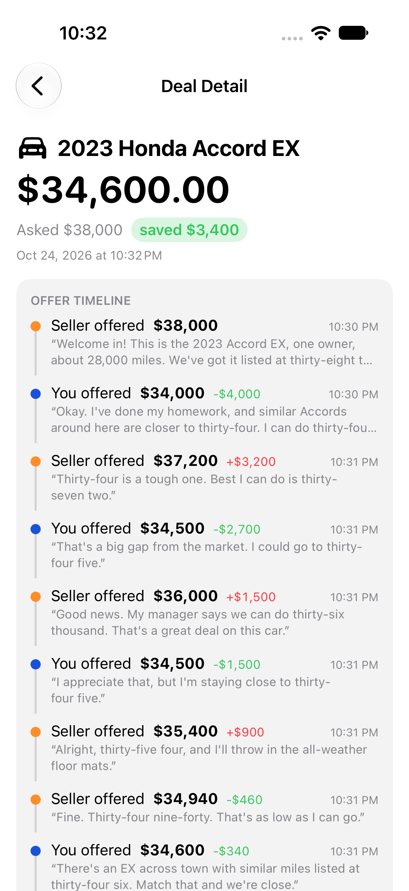
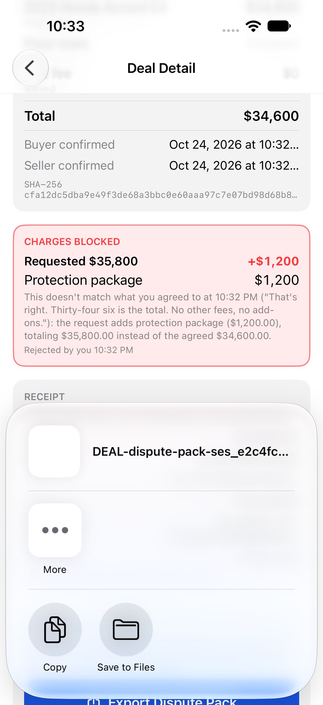
`ios/DEAL/Buyer/PurchaseHistoryView.swift`
- **History:**
  - Totals: amount spent, saved vs asking, extra charges blocked.
  - List of paid deals with a category icon, item, date, final price and "saved $X" in green.
- **Deal Detail:**
  - Header: item, final price, "Asked $38,000" with a saved badge, date.
  - **Offer timeline:** every offer from either side, with the change from the previous offer and the quoted transcript line.
  - Key cues, with their tactic.
  - The agreement: terms, confirmations, full fingerprint.
  - Blocked charges with the AI's explanation, and the receipt.
  - **Export Dispute Pack**, which shares a JSON file through the iOS share sheet.
- The detail page is long. Only its top shows in the screenshot, so the timeline could use a more compact design.

---

## Seller mode

The seller never sees cues or the transcript, because the coaching is private to the buyer.

### S1. Join Session
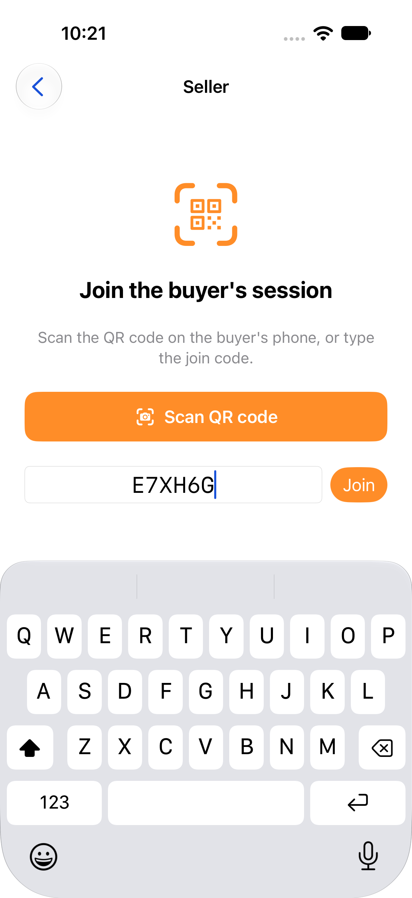
`ios/DEAL/Seller/JoinSessionView.swift`
- Type the join code or **Scan QR**.
- The camera scanner (`QRScannerView.swift`) isn't pictured, because the Simulator has no camera.

### S2. Live View
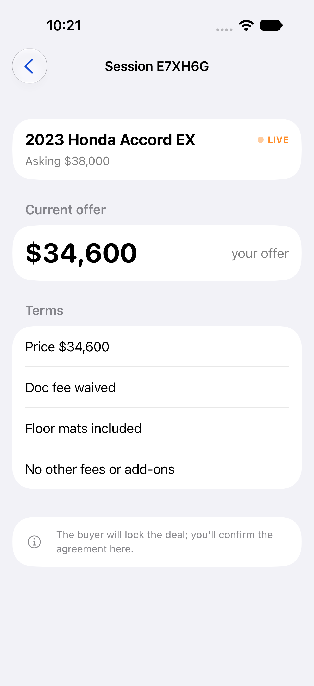
`ios/DEAL/Seller/SellerFlowView.swift`
- Item, current offer, terms list.

### S3. Agreement Review
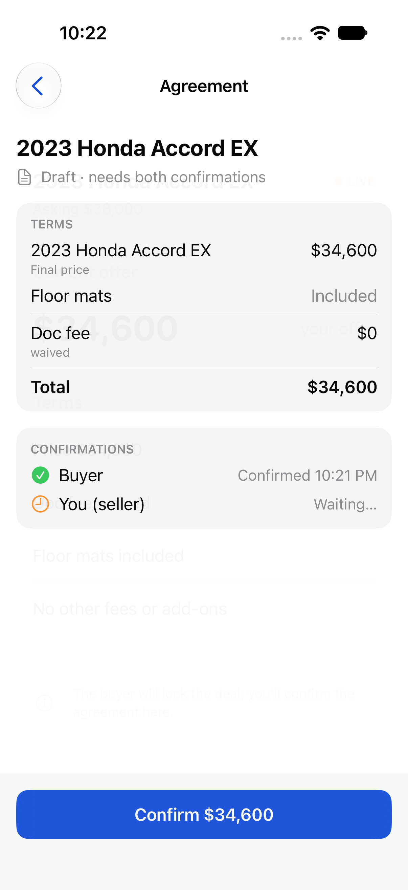
- The same agreement the buyer sees, with **Confirm**.

### S4. Tap to Pay Terminal
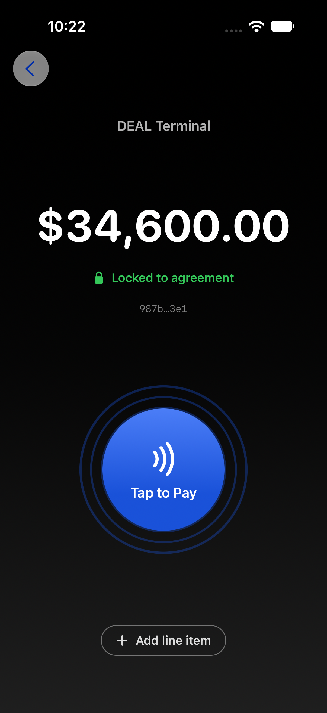
`ios/DEAL/Seller/TerminalView.swift`
- "DEAL Terminal" with a full-screen amount **taken from the agreement and not editable**, plus "🔒 Locked to agreement".
- **Tap to Pay** and **+ Add line item**.

**States:**

| State | Screenshot |
|---|---|
| Add line item sheet (pre-filled "protection package", $1,200) | 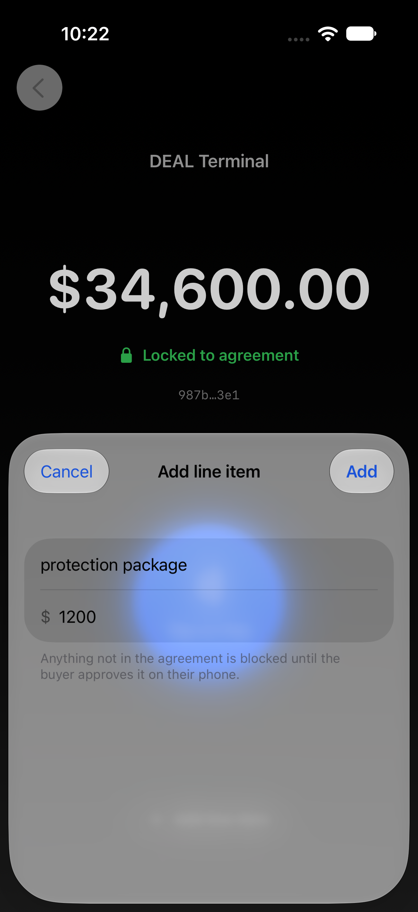 |
| Waiting for buyer approval ($35,800.00 requested) | 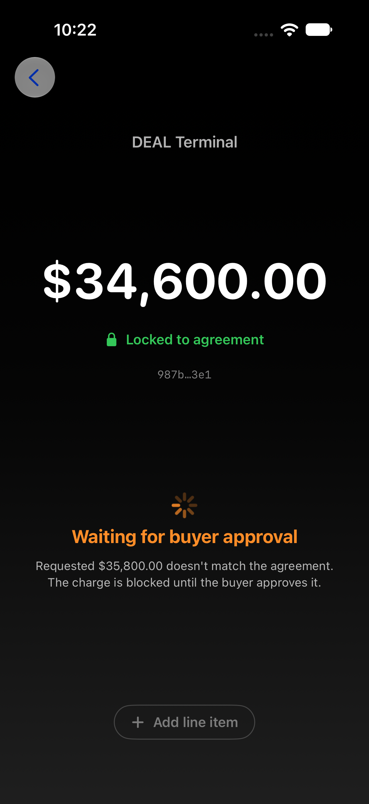 |
| Buyer rejected the change | 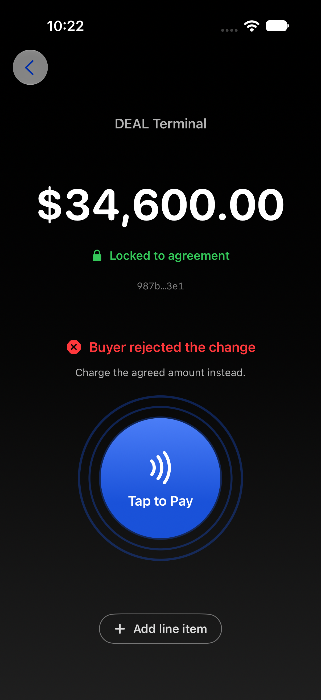 |
| Tap to Pay animation (simulated) | 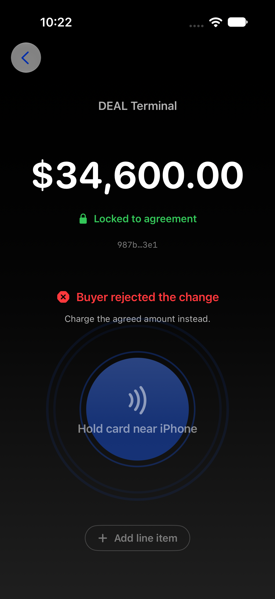 |

### S5. Receipt
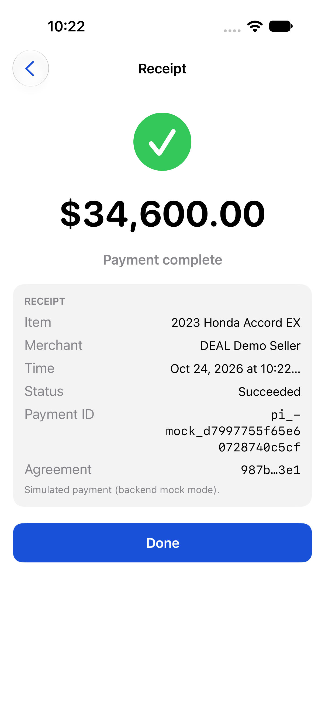
- Same payment confirmation as the buyer's.

---

## Glasses display (not a phone screen)

This is what appears in the Ray-Ban Meta Display lens, a 600×600 monocular display.

**Design limits:**
- Only primary and secondary text colors, so status color comes from a small dot image.
- Black renders as transparent.
- Each update replaces the whole card.

**Card layout:**
- Status dot and word (GOOD / CAREFUL / WARNING / ALERT)
- Cue as a heading
- Optional detail line
- "Offer $X  Target $Y"

The code is in `ios/DEAL/Glasses/MetaGlassesDisplay.swift`. The teleprompter (B3b) is the closest phone equivalent.
